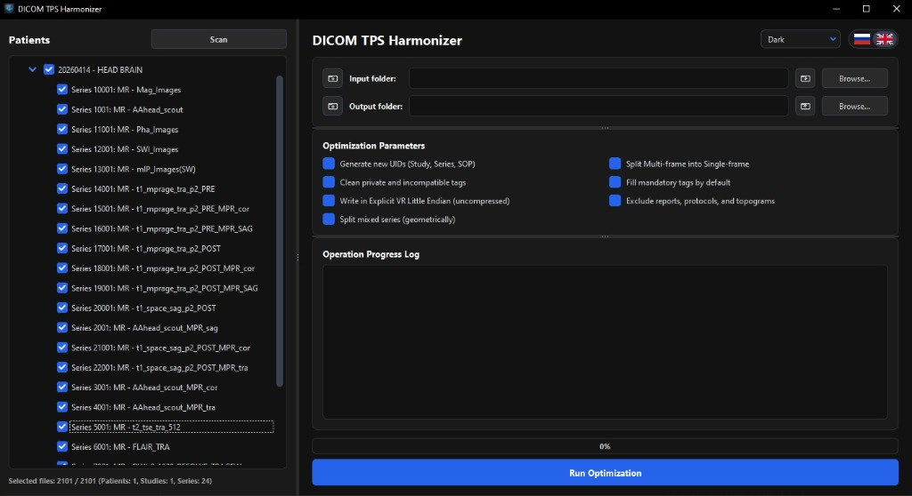
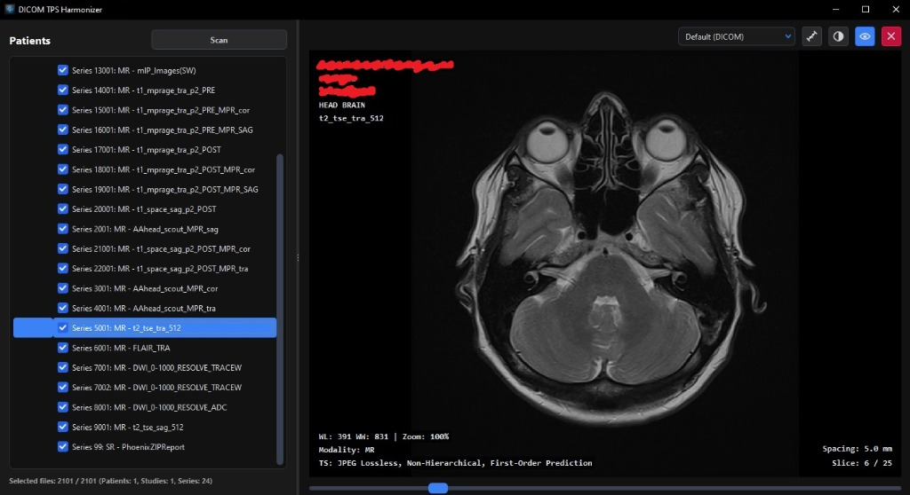
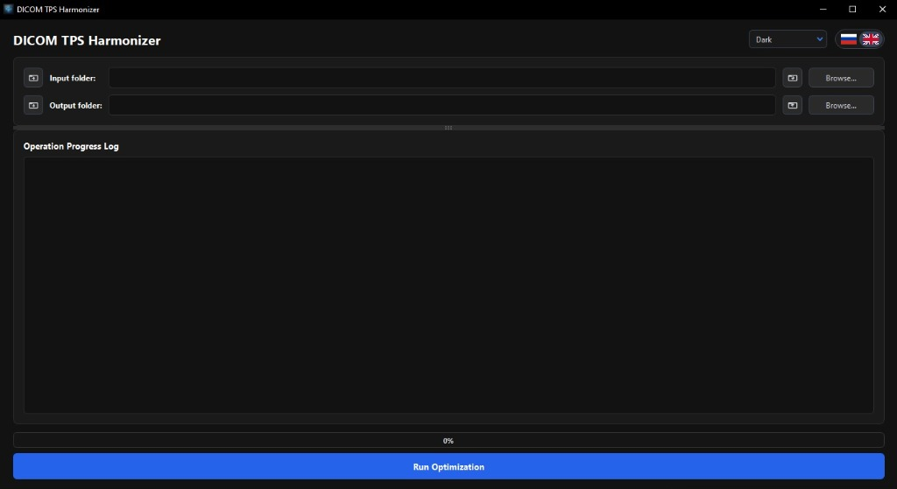

# DICOM TPS Harmonizer

[Русский](#русский) | [English](#english)

---



<details>
  <summary><b>DICOM Viewer Screenshot (Интерактивный вьюер)</b></summary>
  <br/>
  
</details>

<details>
  <summary><b>Interface Customization (Кастомизация интерфейса / Темы)</b></summary>
  <br/>
  
</details>

---

## Русский

**DICOM TPS Harmonizer** — это приложение с графическим интерфейсом для разделения мультифреймовых DICOM-файлов на одиночные срезы и оптимизации их метаданных под планирующие системы (TPS) **Varian Eclipse** и **Elekta Monaco**.

### Основные возможности
* **Разделение мультифреймов:** Преобразует файлы Enhanced DICOM в классические single-frame срезы.
* **Совместимость с TPS:** Очищает приватные теги, генерирует новые UID и приводит файлы к стандарту, необходимому для Eclipse и Monaco.
* **Автоматическое исправление (Siemens EOF Fix):** На лету восстанавливает поврежденные файлы, у которых отсутствует концевой маркер последовательности пикселей.
* **Удобная структура папок:** Группирует результаты в виде:  
  `Dicom_output / <Имя_Пациента>_<ID_Пациента> / <Модальность_Описание_Серии> / slice_XXXX.dcm`
* **Интерактивный DICOM вьюер:** Встроенный инструмент просмотра серий с поддержкой масштабирования (Zoom), перемещения (Pan), измерительной линейки и тонкой настройки HU через слайдеры панели управления.
* **Drag-and-Drop:** Удобный импорт путей перетаскиванием файлов или папок прямо в поля ввода.
* **Современный GUI:** Интерфейс на базе `PyQt6` (с автоматическим режимом совместимости на `PyQt5` в Legacy-сборке), автоподбором размеров проводника пациентов и цветовым логированием в реальном времени.
* **Мультиязычность:** Встроенная поддержка русского и английского языков для интерфейса и логов процессора.

### Редакции готовых сборок (EXE)
В разделе [Releases](https://github.com/Flacozyabra/DICOM_TPS_Harmonizer/releases) на GitHub доступны **две версии** исполняемого файла — выберите подходящую для вашего компьютера (автообновление автоматически сохраняет выбранную редакцию):

* **`DICOM_TPS_Harmonizer.exe`** *(Основная редакция — рекомендуется для Windows 10 1903+ / Windows 11)*
  * Собрана на **Python 3.12** и **`PyQt6`**.
  * Предназначена для современных рабочих станций. При отсутствии системных библиотек C++ может потребовать пакет [Microsoft Visual C++ Redistributable (2015–2022 x64)](https://learn.microsoft.com/en-us/cpp/windows/latest-supported-vc-redist).
* **`DICOM_TPS_Harmonizer_Legacy.exe`** *(Совместимая редакция — для Windows 7 / 8.1 и старых сборок Windows 10)*
  * Собрана на **Python 3.8.10** и **`PyQt5`** (через встроенный слой совместимости).
  * Предназначена для устаревших ПК, корпоративных сборок Windows 10 LTSC (1607/1809), Windows Server или компьютеров, на которых основная версия не запускается с ошибкой `DLL load failed while importing QtWidgets`.

### Сборка EXE из исходников
Перед сборкой установите `pyinstaller` (и `PyQt5` для Legacy-версии):
* **Основная редакция (`DICOM_TPS_Harmonizer.exe`):** сборка на Python 3.10+ и `PyQt6`:
  ```bash
  python build_PyQt6.py
  ```
* **Совместимая редакция (`DICOM_TPS_Harmonizer_Legacy.exe`):** для поддержки Windows 7 сборку необходимо выполнять на **Python 3.8** с `PyQt5`:
  ```bash
  python build_PyQt5_Legacy.py
  ```

### Быстрый запуск из исходников (Windows)
Просто запустите файл [run.bat](run.bat) в корневой папке проекта. Он автоматически активирует виртуальное окружение и запустит программу.

### Установка вручную
1. Создайте виртуальное окружение: `python -m venv .venv`
2. Активируйте его: `.venv\Scripts\activate` (Windows) или `source .venv/bin/activate` (Linux/macOS)
3. Установите зависимости: `pip install -r requirements.txt`
4. Запустите: `python main.py` *(для принудительного запуска под `PyQt5` задайте `FORCE_PYQT5=1`)*

---

## English

**DICOM TPS Harmonizer** is a desktop GUI application designed to split multi-frame DICOM files into classic single-frame slices and optimize their metadata for **Varian Eclipse** and **Elekta Monaco** Treatment Planning Systems (TPS).

### Key Features
* **Multi-frame Splitting:** Converts Enhanced DICOM datasets into standard single-frame slices.
* **TPS Compatibility:** Filters incompatible private tags, generates clean UIDs, and standardizes files for Eclipse & Monaco imports.
* **On-the-fly Recovery (Siemens EOF Fix):** Automatically fixes and parses truncated files lacking sequence delimiters.
* **Clear Directory Hierarchy:** Outputs structured patient datasets:  
  `Dicom_output / <PatientName>_<PatientID> / <Modality_SeriesDescription> / slice_XXXX.dcm`
* **Interactive DICOM Viewer:** Integrated series visualization featuring Zoom, Pan, measurement ruler, and HU window Level/Width sliders.
* **Drag-and-Drop Support:** Drag folders or files directly into path input fields.
* **Modern GUI:** Sleek interface built with `PyQt6` (with automatic `PyQt5` compatibility layer in the Legacy edition), featuring automatic patient explorer resizing and real-time color logging.
* **Multi-language support:** Built-in Russian and English localizations for both GUI and execution logs.

### Executable (EXE) Editions
Two standalone Windows `.exe` editions are available in the [Releases](https://github.com/Flacozyabra/DICOM_TPS_Harmonizer/releases) section — choose the one that best fits your system (auto-update automatically preserves your current edition):

* **`DICOM_TPS_Harmonizer.exe`** *(Modern Edition — recommended for Windows 10 1903+ / Windows 11)*
  * Built on **Python 3.12** with **`PyQt6`**.
  * Recommended for modern workstations. May require [Microsoft Visual C++ Redistributable (2015–2022 x64)](https://learn.microsoft.com/en-us/cpp/windows/latest-supported-vc-redist) if missing on the target machine.
* **`DICOM_TPS_Harmonizer_Legacy.exe`** *(Compatibility Edition — Windows 7 / 8.1 / Legacy Windows 10)*
  * Built on **Python 3.8.10** with **`PyQt5`** via the built-in compatibility shim.
  * Designed for legacy workstations, Windows 10 LTSC (1607/1809), Windows Server, or machines where the modern build fails with `DLL load failed while importing QtWidgets`.

### Building EXE from source
Install `pyinstaller` (and `PyQt5` for the Legacy edition) before building:
* **Modern Edition (`DICOM_TPS_Harmonizer.exe`):** compile using Python 3.10+ and `PyQt6`:
  ```bash
  python build_PyQt6.py
  ```
* **Legacy Edition (`DICOM_TPS_Harmonizer_Legacy.exe`):** use **Python 3.8** with `PyQt5` for full Windows 7 compatibility:
  ```bash
  python build_PyQt5_Legacy.py
  ```

### Quick Start from source (Windows)
Double-click [run.bat](run.bat) in the project folder. It will configure the virtual environment and start the application automatically.

### Manual Installation
1. Create virtual environment: `python -m venv .venv`
2. Activate it: `.venv\Scripts\activate` (Windows) or `source .venv/bin/activate` (Linux/macOS)
3. Install dependencies: `pip install -r requirements.txt`
4. Launch the app: `python main.py` *(set `FORCE_PYQT5=1` to force running with `PyQt5`)*
